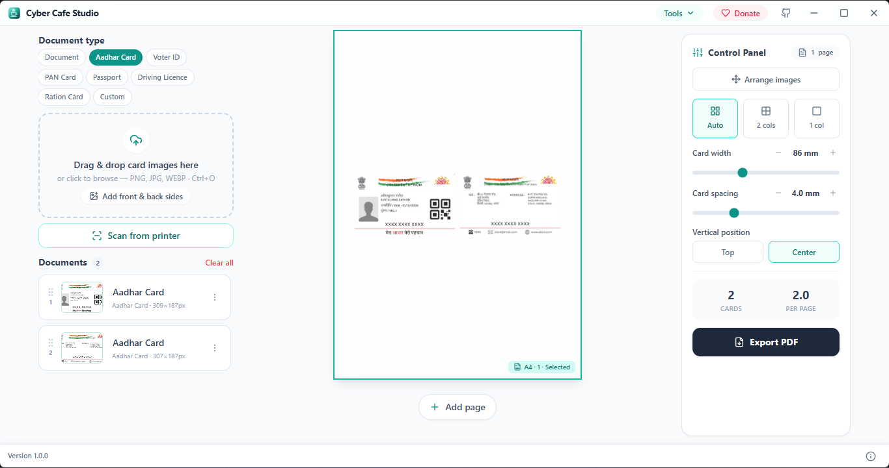
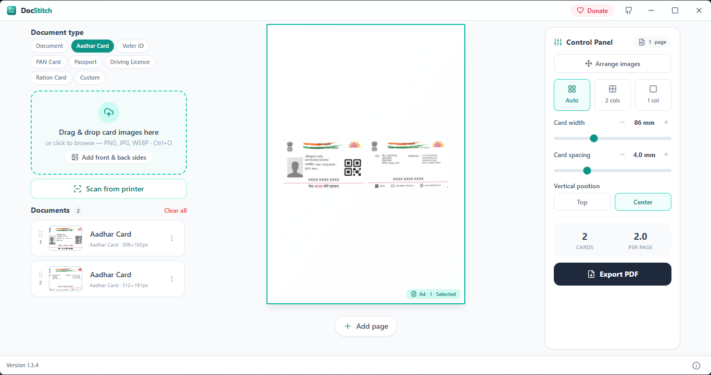
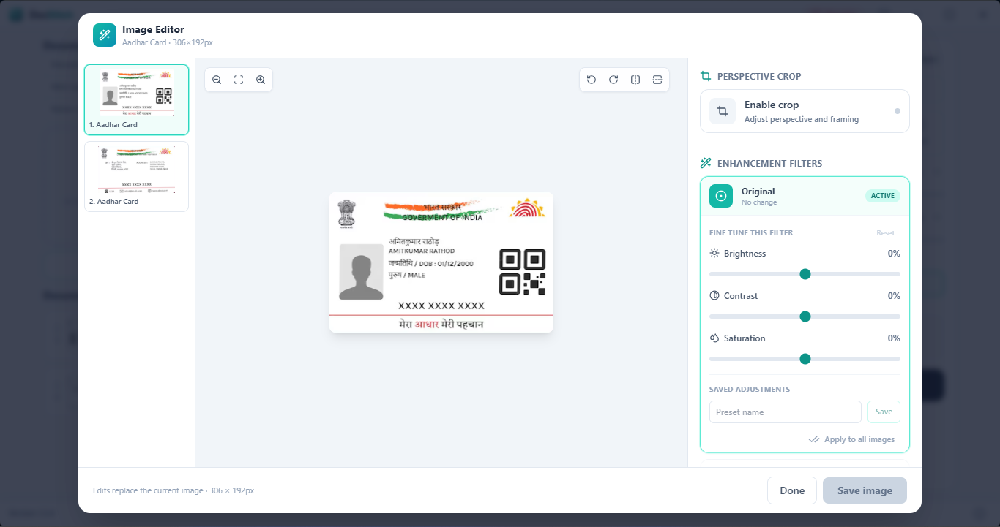

# Cyber Cafe Studio – Document Image Arrangement & Printing for Windows

**Cyber Cafe Studio** is a Windows desktop application that makes it easy to arrange the front and back sides of documents, such as Aadhaar cards and voter ID cards, on a single A4 page.

Designed for online service centers, cyber cafés, printing shops, and everyday users, Cyber Cafe Studio simplifies document preparation for printing, photocopying, and government portal uploads.

## Features

- Combine front and back document images on one page.
- Arrange document images for A4 printing.
- Prepare Aadhaar card and voter ID layouts.
- Merge multiple PDFs or compress a PDF locally on your device.
- Remove photo backgrounds and preview transparent or solid-color PNGs.
- Simplify document image preparation for online service centers.
- Use a Windows desktop interface for everyday document workflows.

## Photo Background Remover

The portrait background remover runs locally with the [MODNet ONNX model](https://huggingface.co/Xenova/modnet) and ONNX Runtime through [Transformers.js](https://github.com/huggingface/transformers.js). The Apache-2.0 model weights (about 26 MB) are downloaded from Hugging Face the first time and cached for later use. Photos are processed on the device and are not uploaded to a background-removal service. MODNet is optimized for portraits and may not perform as well on non-person objects.

## PDF Tools

PDF merging combines selected files in the chosen order and keeps their pages. PDF compression runs locally by converting pages to images at a selected resolution and JPEG quality. This can reduce file size, but compressed PDFs no longer have selectable/searchable text, and forms, links, or digital signatures are not preserved. The original PDF is not changed.

## Who Is Cyber Cafe Studio For?

- Online service center operators
- Cyber café owners
- Photocopy and printing shops
- People who need to arrange document images for printing

## Download

Download the latest Windows release from the [Cyber Cafe Studio GitHub Releases](https://github.com/tuhin733/DocStich/releases).

## Source Code

Explore the [Cyber Cafe Studio repository](https://github.com/tuhin733/DocStich).

## Screenshots

## Keywords

Document image arrangement, Aadhaar card front and back printing, voter ID printing, A4 document layout, Windows document printing software, and document image processing.